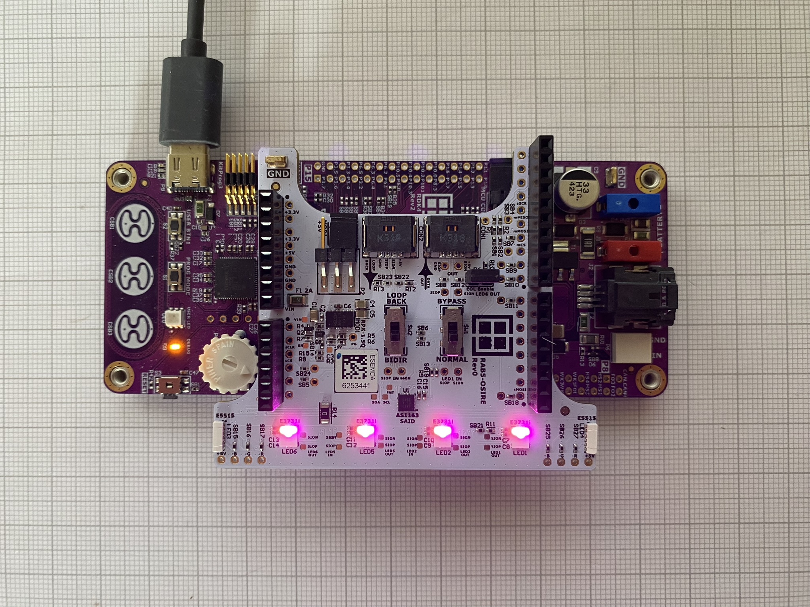

# RDK4 - RAB5-OSIRE communication control code example



**NOTE:**  The current up to 100 mA may flow from the System Basis Chip [U1] TLE9262-3BQXV33 VCC2 LDO Output. If more current is needed, please use the RDK4 BATTERY supply terminals J2 and J4 and switch to the RECOM RPX-1.5Q power supply on the RAB5-OSIRE board [Switch the jumper from pins 2 and 3 to pins 1 and 2 on the P2 port]. This would increase the current limit to 1.5A.

## Requirements

- [ModusToolbox™ software ](https://www.infineon.com/design-resources/development-tools/sdk/modustoolbox-software) v3.7
- [RDK4 Rev2.](https://www.rutronik24.com/product/rutronik/rdk4/20820197.html)
- [RAB5-OSIRE](https://www.rutronik24.com/product/rutronik/rab5osire/23450204.html)

## Supported toolchains (make variable 'TOOLCHAIN')

- GNU Arm&reg; Embedded Compiler v14.2.1 (`GCC_ARM`) - Default value of `TOOLCHAIN`

### Operation

The system initializes the LEDs and wait for a command coming from the UART port.

See below to see how a command is constructed (header: 0x31, LED address and then R, G, B color).

```python
def send_osire_cmd(port_num, addr, r, g, b):
    port = f"COM{port_num}"
    ser = serial.Serial(port, 115200, timeout=1)
    ser.write((0x31).to_bytes(length=1, signed=False))
    ser.write(addr.to_bytes(length=1, signed=False))
    ser.write(r.to_bytes(length=2, byteorder='little', signed=False))
    ser.write(g.to_bytes(length=2, byteorder='little', signed=False))
    ser.write(b.to_bytes(length=2, byteorder='little', signed=False))
    ser.close()
```

## Legal Disclaimer

The evaluation board including the software is for testing purposes only and, because it has limited functions and limited resilience, is not suitable for permanent use under real conditions. If the evaluation board is nevertheless used under real conditions, this is done at one’s responsibility; any liability of Rutronik is insofar excluded. 


